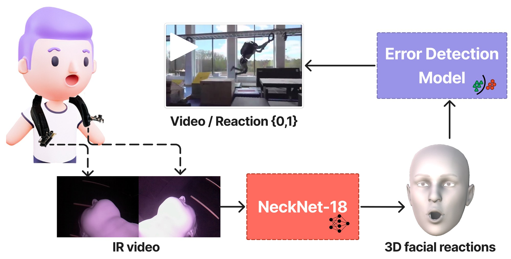

# "Why the face?": Exploring Robot Error Detection Using Instrumented Observer Reactions

<div align="center">

**[Maria Teresa Parreira](https://www.mariateresaparreira.com/)<sup>1,2</sup>, [Ruidong Zhang](https://ruidongzhang.com/)<sup>1</sup>, [Sukruth Gowdru Lingaraju](https://www.linkedin.com/in/glsukruth/)<sup>2</sup>, [Alexandra Bremers](https://bremers.github.io/)<sup>2</sup>, [Xuanyu Fang](https://scholar.google.com/citations?user=Y18d-sUAAAAJ&hl=en)<sup>2</sup>, [Adolfo Ramirez-Aristizabal](https://scholar.google.com/citations?user=iF7yqHkAAAAJ&hl=en)<sup>3</sup>, [Manaswi Saha](https://manaswisaha.github.io/)<sup>3</sup>, [Michael Kuniavsky](https://scholar.google.com/citations?user=KtPU2SMAAAAJ&hl=en)<sup>3</sup>, [Cheng Zhang](https://czhang.org)<sup>1</sup>, [Wendy Ju](https://wendyju.com/)<sup>1,2</sup>**

<sup>1</sup>Cornell University | <sup>2</sup>Cornell Tech | <sup>3</sup>Accenture Labs

*ACM Transactions on Human-Robot Interaction (THRI), 2026*

[Project Page](https://irl.tech.cornell.edu/badrobots-feat-neckface/) | [Paper](docs/static/pdfs/paper.pdf) | [Supplementary Material](docs/static/pdfs/supplementary.pdf)

</div>

---

<p align="center">
  
  <br/>
  <em>Participants wearing NeckFace watch videos in which a human or robot error occurs (or does not). NeckNet-18 converts the neckband's IR camera images into 3D facial expression and head rotation data, which trains models that detect whether the person is reacting to an error.</em>
</p>

## Abstract

How do humans recognize and rectify social missteps? We achieve social competence by looking around at our peers, decoding subtle cues from others around us — a raised eyebrow, a laugh — to evaluate the environment and our actions. Robots, however, struggle to perceive and make use of these nuanced reactions. By employing a novel neck-mounted device that records facial expressions from the chin region, we explore the potential of previously untapped data to capture and interpret human responses to robot error. First, we develop NeckNet-18, a 3D facial reconstruction model to map the reactions captured through the chin camera onto facial points and head motion. We then use these facial responses to develop a robot error detection model which outperforms standard methodologies such as using OpenFace or video data, generalizing well especially for within-participant data. Through this work, we argue for expanding human-in-the-loop robot sensing, fostering more seamless integration of robots into diverse human environments, pushing the boundaries of social cue detection and opening new avenues for adaptable robotics.

## Contributions

1. **NeckNet-18**: a lightweight 3D facial reconstruction model (ResNet-18 backbone) that converts IR images from a neck-mounted device into 52 facial Blendshapes and 3 head rotation angles.
2. **Error detection from observer reactions**: models trained on NeckNet-18 output (NeckData) detect when a person is reacting to an error. They are compared against OpenFace features (OpenData) and raw IR and RGB frames.
3. **Benchmark**: neck-mounted reaction data compared with conventional camera-based inputs, using matched stimuli and the same model search for both time-series data sources.

## Repository Structure

```
.
├── docs/                                 # Project page (GitHub Pages)
│   └── static/pdfs/                      # Paper and supplementary material
├── code_neckface_training/               # NeckNet-18: data preparation, training, inference (see its README)
├── code_preprocessing/                   # Dataset creation from raw recordings, feature analysis
│   └── create_datasets/                  # NeckFace IR / RGB frame extraction, OpenFace processing (see its README)
├── code_timeseries/                      # Time-series error detection models
│   ├── tsai/                             # tsai models (GRU_FCN, LSTM_FCN, gMLP, InceptionTime, MiniRocket, ...)
│   ├── general_code/                     # Keras/PyTorch GRU, LSTM, MLP and Transformer sweeps
│   └── transformer/                      # Transformer model
├── code_rgb/                             # Frame-based (ResNet) error detection models
├── submission/                           # Figures from the original submission
└── stimulus_dataset_information.xlsx     # The 30 stimulus videos: sources, type, error timestamps
```

## NeckNet-18: 3D Facial Reconstruction

See [`code_neckface_training/README.md`](code_neckface_training/README.md) for the expected data layout and `config.json` format.

```bash
cd code_neckface_training

# Prepare a participant's calibration data
python data_preparation.py -p /path/to/participant/data

# Fine-tune NeckNet from pre-trained weights
python train.py -p /path/to/participant/data -ts 01 -g 0 -t 1 -o experiment_name \
    --resume /path/to/neckface_us_full_model.tar --epochs-to-run 30 --lr 0.0002

# Predict Blendshapes and head rotation for new videos
python eval.py --resume /path/to/checkpoint.tar -v /path/to/video.avi
```

**Pre-trained weights:** [neckface_us_full_model.tar](https://cornell.box.com/s/cuqqeuz9eqyauwbkb1rkakqi6vul21op)

## Error Detection Models

The time-series experiments in `code_timeseries/tsai/` are driven by [Weights & Biases](https://wandb.ai) sweeps. `TimeSeries_Helpers.py` holds the training and cross-validation logic, and `create_data_splits.py` builds the participant-level folds: in each of the 5 folds, 17 participants are used for training, 5 for validation and 3 for testing (15 of the 25 participants are tested across the folds). An earlier version of `create_data_splits_ids` returned the folds as `(val, test, train)` while every caller unpacks `(train, val, test)`, so runs made with it trained on 5 participants; this is fixed here. The scripts read their input from `../../data/` (`training_data.csv`, `training_data_norm.csv`, `training_data_pca.csv`). Pinned dependencies are in [`code_timeseries/tsai/requirements.txt`](code_timeseries/tsai/requirements.txt).

| Script | Purpose |
|---|---|
| `all_models.py` | Cross-participant hyperparameter search over model types (`cross_validate`) |
| `bestcandidates.py` | Re-runs top configurations with validation-based best-epoch selection (`cross_validate_bestepoch`) |
| `best_model_save.py` | Trains and saves the selected models (`cross_validate_bestmodel`) |
| `best_model_retrain.py` | Cross-training: fine-tunes a model pre-trained on one dataset on the other (`cross_validate_pretrained`) |
| `all_models_pp.py` | Single-participant hyperparameter search with 5%, 10%, 25% and 45% of each participant's data for training (`cross_validate_pp`) |
| `bestepoch_pp.py` | Re-runs the top single-participant configurations for each training-set size (`cross_validate_pp`) |
| `get_metrics.py` | Accuracy, precision, recall and F1, with optional time tolerance |

In the single-participant scripts, each participant's frames are shuffled, a random 5–45% is used for training, a further 20% of that amount for validation, and the rest for testing. The data loader for these scripts also reads `../../data/vit_features.csv`, even though they use the facial features only.


The hyperparameter ranges searched for each model type are listed in the supplementary material.

## Datasets

| Dataset | Description | Neutral (0) | Error (1) | Total frames |
|---|---|---:|---:|---:|
| NeckData | 55 features (52 Blendshapes + 3 head rotations) reconstructed from NeckFace IR by NeckNet-18 | 51,745 | 37,815 | 89,560 |
| OpenData | 49 OpenFace action unit, gaze and pose features from the participant-facing webcam | 51,580 | 37,815 | 89,395 |
| NeckFaceIR | Raw NeckFace IR frames | 51,745 | 37,815 | 89,560 |
| RGBData | Raw webcam frames | 51,578 | 37,815 | 89,393 |

All datasets are at 12 fps (RGB-derived data downsampled from 30 fps). The stimulus set has 30 videos: 10 human failures, 10 robot failures and 10 controls (see `stimulus_dataset_information.xlsx`).

## Results

### NeckNet-18 (5-fold temporal cross-validation, mean ± SD)

| | MAE, facial Blendshapes | MAE, head rotation |
|---|---:|---:|
| NeckNet-18 (this work) | 34.0 ± 6.9 | 7.0 ± 1.3 |
| Original NeckNet ([Chen et al., 2021](https://doi.org/10.1145/3463511)) | 25.6 ± 5.1 | 3.1 |

### Error detection (test set, best model per protocol and data source)

| Protocol | Model | Dataset | Accuracy | Precision | Recall | F1 |
|---|---|---|---:|---:|---:|---:|
| Cross-participant | gMLP | OpenData | 0.606 ± 0.051 | 0.563 ± 0.025 | 0.632 ± 0.072 | 0.535 ± 0.015 |
| Cross-participant | GRU_FCN | **NeckData** | 0.658 ± 0.061 | 0.649 ± 0.060 | 0.667 ± 0.052 | 0.637 ± 0.070 |
| Pre-trained, fine-tuned | gMLP | OpenData | 0.569 ± 0.040 | 0.547 ± 0.028 | 0.572 ± 0.075 | 0.538 ± 0.019 |
| Pre-trained, fine-tuned | gMLP | **NeckData** | 0.619 ± 0.057 | 0.597 ± 0.042 | 0.619 ± 0.057 | 0.589 ± 0.047 |
| Single-participant, 5% train | InceptionTime | OpenData | 0.788 ± 0.049 | 0.782 ± 0.048 | 0.785 ± 0.050 | 0.782 ± 0.049 |
| Single-participant, 5% train | GRU_FCN | **NeckData** | 0.847 ± 0.048 | 0.840 ± 0.048 | 0.846 ± 0.050 | 0.842 ± 0.049 |
| Single-participant, 45% train | InceptionTime | OpenData | 0.965 ± 0.019 | 0.963 ± 0.020 | 0.965 ± 0.020 | 0.964 ± 0.020 |
| Single-participant, 45% train | GRU_FCN | **NeckData** | 0.955 ± 0.028 | 0.954 ± 0.029 | 0.954 ± 0.029 | 0.954 ± 0.029 |
| Frame-based | ResNet34 | RGBData | 0.515 ± 0.025 | 0.505 ± 0.020 | 0.505 ± 0.018 | 0.493 ± 0.023 |
| Frame-based | ResNet34 | **NeckFaceIR** | 0.530 ± 0.031 | 0.504 ± 0.027 | 0.501 ± 0.016 | 0.474 ± 0.014 |

Cross-participant results are mean ± SD over 5 participant-level folds. Single-participant results are mean ± SD over all 25 participants.

**Summary:** NeckData beats OpenFace features on unseen participants and, by the widest margin, when personalizing with very little data (5%). With 45% of a participant's data both sources exceed 95% and OpenData is slightly ahead. Raw-frame CNNs perform only slightly above chance.

## Hardware

- **Cameras**: 2× IR cameras (Arducam) on a neckband, connected to a single Raspberry Pi 4B through an Arducam multi-camera adapter
- **Calibration ground truth**: iPhone 11 Pro TrueDepth camera (ARKit Blendshapes)

For device fabrication, see [NeckFace: Continuously Tracking Full Facial Expressions on Neck-mounted Wearables](https://doi.org/10.1145/3463511).

## Citation

```bibtex
@article{parreira2026whyface,
  title   = {``Why the face?'': Exploring Robot Error Detection Using Instrumented Observer Reactions},
  author  = {Parreira, Maria Teresa and Zhang, Ruidong and Gowdru Lingaraju, Sukruth and Bremers, Alexandra and Fang, Xuanyu and Ramirez-Aristizabal, Adolfo and Saha, Manaswi and Kuniavsky, Michael and Zhang, Cheng and Ju, Wendy},
  journal = {ACM Transactions on Human-Robot Interaction},
  year    = {2026},
  publisher = {ACM}
}
```

## Related Work

- **NeckFace**: [Chen et al., 2021](https://doi.org/10.1145/3463511). The original neck-mounted facial expression tracking system.
- **BAD Dataset**: [Bremers et al., 2023](https://arxiv.org/abs/2303.04835). The Bystander Affect Detection dataset for failure detection in HRI.
- **Social cues for failure detection**: [Bremers et al., 2024](https://arxiv.org/abs/2301.11972). Overview, state of the art and future directions.
- **ERR@HRI Challenge**: [Spitale et al., 2024](https://arxiv.org/abs/2407.06094). Multimodal detection of errors and failures in HRI.

## Acknowledgments

This work was supported by Cornell University and Accenture Labs. We thank all participants in our user study, and the original NeckFace team for the foundational device and pre-trained models.

## License

This project is licensed under the MIT License. See [LICENSE](LICENSE) for details. The project page in `docs/` is adapted from the [Academic Project Page Template](https://github.com/eliahuhorwitz/Academic-project-page-template) (CC BY-SA 4.0).

## Contact

For questions or issues, please open an issue on GitHub or contact Maria Teresa Parreira (mb2554@cornell.edu).
